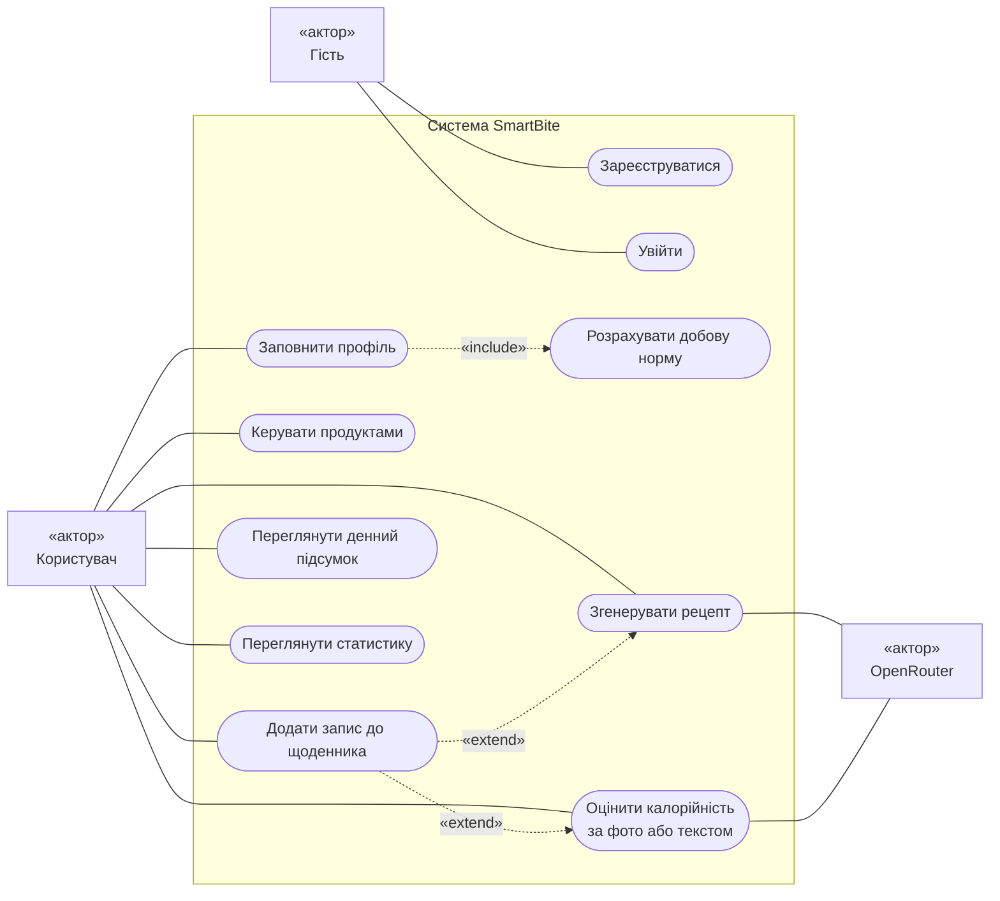
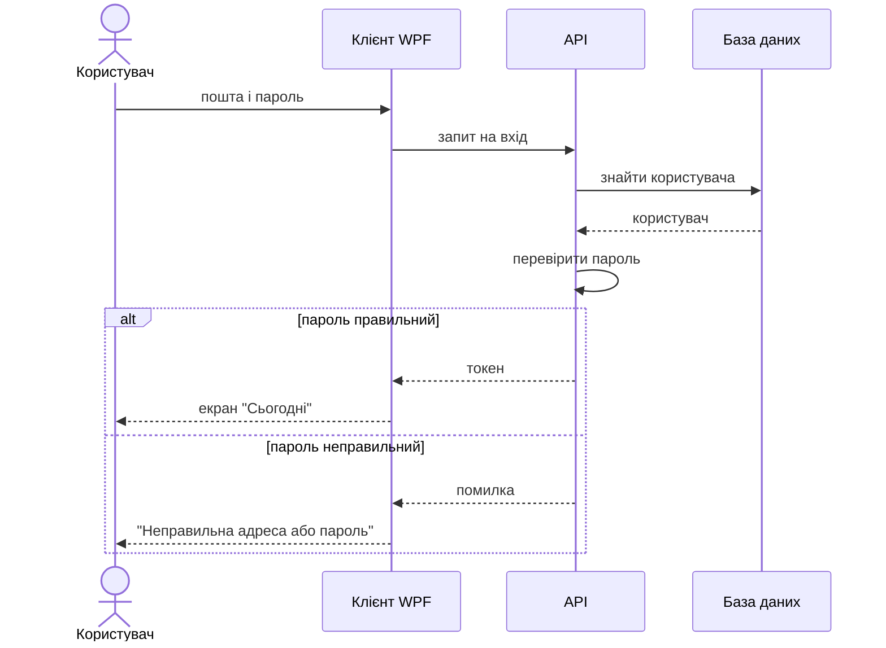
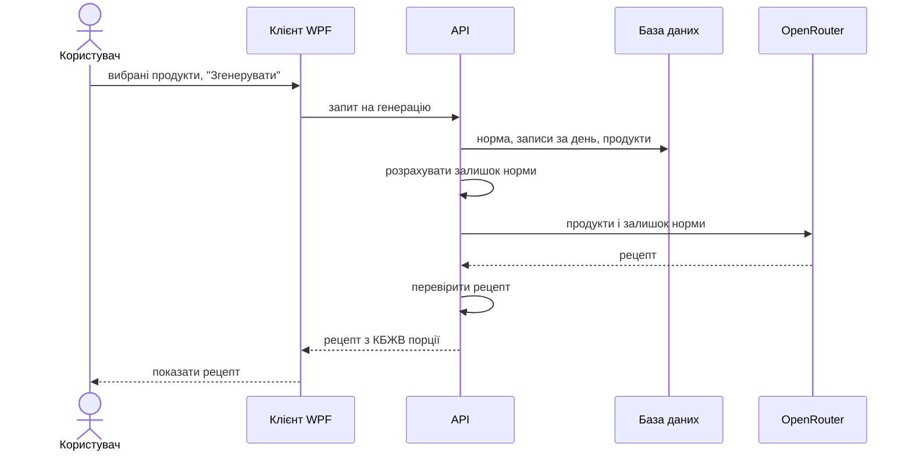
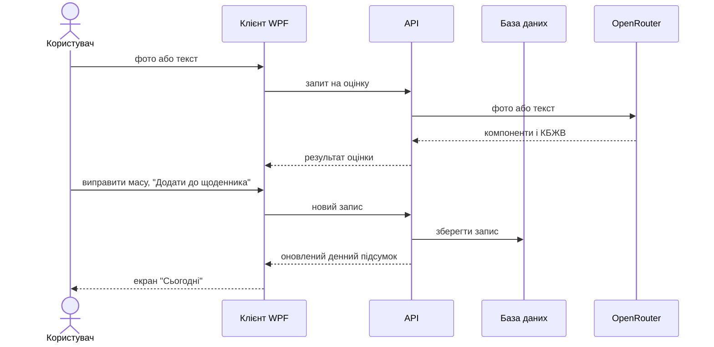
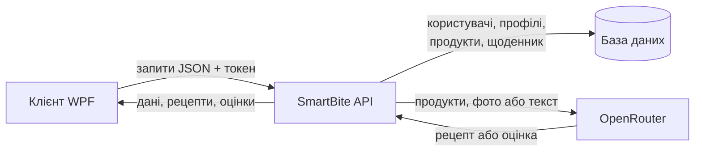

# UML-діаграми та основні сценарії

Документ містить моделі етапу 3: діаграму варіантів використання, короткий опис основних сценаріїв, діаграми послідовності та схему потоків взаємодії.

## 1. Актори

- **Гість** - ще не увійшов до системи; може зареєструватися або увійти.
- **Користувач** - автентифікований користувач; виконує всі інші дії.
- **OpenRouter** - зовнішній сервіс мовних моделей; генерує рецепти та оцінює калорійність.

## 2. Діаграма варіантів використання

## 3. Основні сценарії

| Сценарій                     | Короткий опис                                                                                                                              | Історії     |
| ---------------------------- | ------------------------------------------------------------------------------------------------------------------------------------------ | ----------- |
| Реєстрація та вхід           | Користувач вводить пошту й пароль. Після реєстрації відкривається профіль, після входу - екран "Сьогодні".                                 | US-1        |
| Профіль і добова норма       | Користувач вводить параметри тіла, активність і мету; система розраховує добову норму КБЖВ і перераховує її після змін.                    | US-2        |
| Мої продукти                 | Користувач додає, редагує, видаляє та шукає продукти, які є вдома.                                                                         | US-3        |
| Приготувати з наявного       | Користувач вибирає продукти і кількість порцій; система через мовну модель генерує рецепт у межах залишку норми.                           | US-4        |
| Оцінити страву               | Користувач завантажує фото або вводить продукти текстом; система визначає склад і КБЖВ, користувач може виправити масу компонентів.        | US-6, US-7  |
| Запис у щоденник             | Страва з рецепта, з оцінки або введена вручну додається до щоденника; денний підсумок оновлюється.                                          | US-5, US-9  |
| Денний підсумок і статистика | Користувач бачить, скільки спожито і скільки залишилося до норми, а також калорії за останній тиждень.                                     | US-8, US-10 |

Якщо сервіс мовних моделей недоступний, користувач бачить зрозуміле повідомлення, а решта функцій працює далі.

## 4. Діаграми послідовності

### 4.1. Вхід

### 4.2. Генерація рецепта

### 4.3. Оцінка калорійності та запис у щоденник

## 5. Потоки взаємодії

Клієнт працює лише з API. До бази даних і до OpenRouter звертається тільки сервер.

