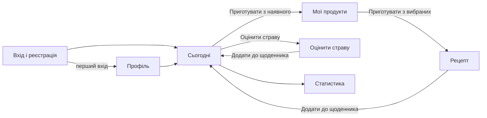
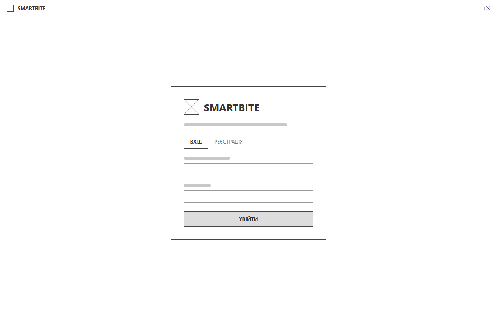
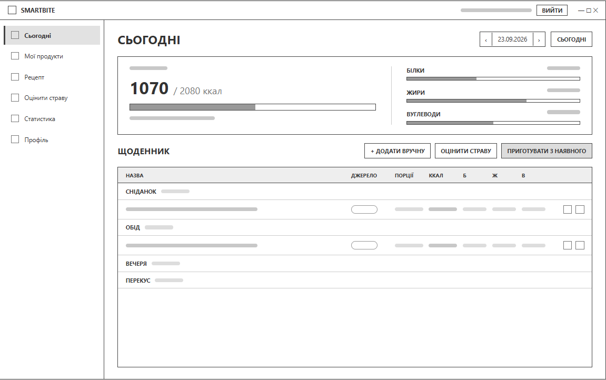
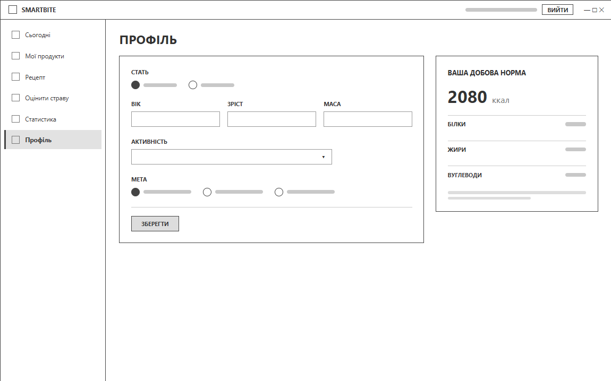
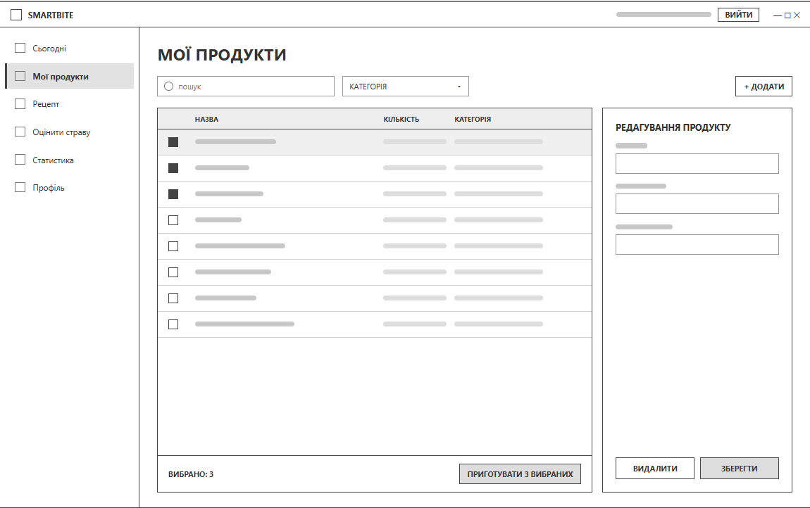
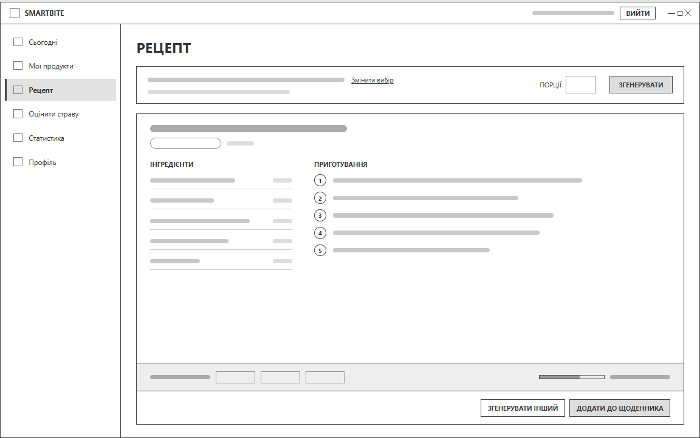
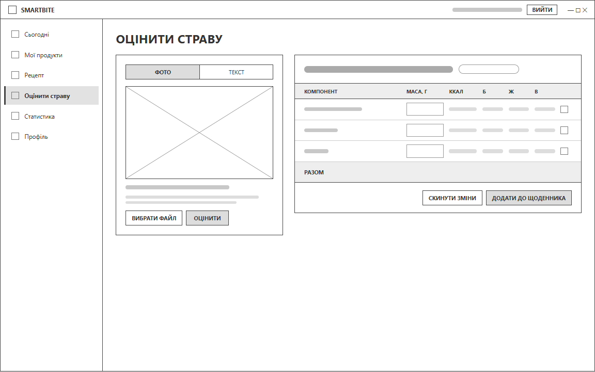
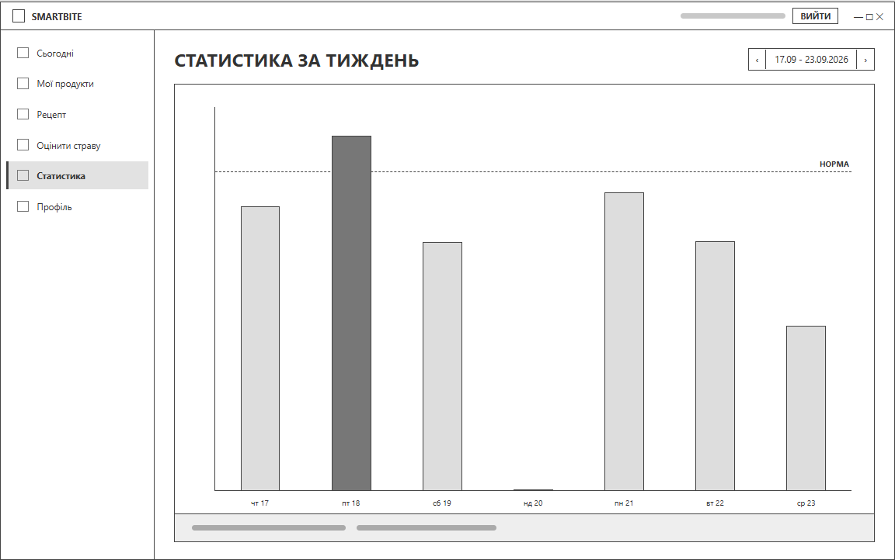

# Макети екранів

Документ містить каркасні макети екранів настільного клієнта. Макети показують розташування елементів, а не остаточне оформлення.

## 1. Загальна структура

- Одне головне вікно. Після входу ліворуч з'являється бічна панель: Сьогодні, Мої продукти, Рецепт, Оцінити страву, Статистика, Профіль.
- У заголовку вікна показано адресу користувача і кнопку "Вийти".
- Результати мовних моделей позначаються як орієнтовні.

## 2. Екрани

### 2.1. Вхід і реєстрація

Форма посередині вікна: назва застосунку, вкладки "Вхід" і "Реєстрація", поля пошти та пароля, кнопка "Увійти". Бічної панелі на цьому екрані немає.

### 2.2. Сьогодні

Головний екран. Угорі - вибір дати. Картка підсумку показує спожиті калорії відносно норми і прогрес за білками, жирами та вуглеводами. Нижче - щоденник, згрупований за прийомами їжі (сніданок, обід, вечеря, перекус), з джерелом запису, порціями і КБЖВ. Кнопки "Додати вручну", "Оцінити страву" і "Приготувати з наявного" запускають основні сценарії.

### 2.3. Профіль

Ліворуч - форма параметрів: стать, вік, зріст, маса, рівень активності, мета. Праворуч - картка з розрахованою добовою нормою калорій, білків, жирів і вуглеводів.

### 2.4. Мої продукти

Пошук за назвою, фільтр за категорією і кнопка "Додати". Таблиця продуктів з кількістю та категорією; прапорцями вибираються продукти для рецепта. Праворуч - панель редагування вибраного продукту. Внизу - кількість вибраних продуктів і кнопка "Приготувати з вибраних".

### 2.5. Рецепт

Угорі - вибрані продукти, кількість порцій і кнопка "Згенерувати". Нижче - згенерований рецепт: назва, час приготування, інгредієнти з грамуванням і кроки приготування. Внизу - КБЖВ однієї порції, частка залишку норми та кнопки "Згенерувати інший" і "Додати до щоденника".

### 2.6. Оцінити страву

Ліворуч - перемикач "Фото / Текст", область попереднього перегляду фото, кнопки "Вибрати файл" і "Оцінити". Праворуч - результат: назва страви, таблиця компонентів із масою, яку можна змінити, КБЖВ і підсумок. Кнопки "Скинути зміни" і "Додати до щоденника".

### 2.7. Статистика

Стовпчикова діаграма калорій за 7 днів із лінією норми. Дні з перевищенням норми виділено, дні без записів мають значення 0. Угорі - перемикач тижня, внизу - короткий підсумок за тиждень.
