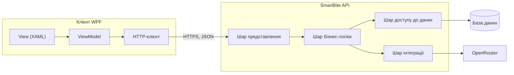

# Архітектура

Документ етапу 4: архітектурний підхід, основні компоненти, їхня взаємодія та обґрунтування ключових рішень.

## 1. Архітектурний підхід

SmartBite побудовано за схемою **клієнт - сервер**:

- **Клієнт WPF** відповідає лише за інтерфейс: показує дані, перевіряє введення і надсилає запити до API. Локально дані не зберігає.
- **SmartBite API** (ASP.NET Core Web API) виконує автентифікацію, бізнес-логіку, збереження даних і звернення до мовних моделей.

Серверна частина має **багатошарову архітектуру**, клієнт побудований за шаблоном **MVVM**.

## 2. Компоненти

| Компонент                 | Відповідальність                                                                          |
| ------------------------- | ----------------------------------------------------------------------------------------- |
| Клієнт WPF                | екрани, перевірка введення, запити до API                                                  |
| Шар представлення         | контролери API, автентифікація за токеном JWT, обробка помилок                             |
| Шар бізнес-логіки         | розрахунок норми, продукти, щоденник, генерація рецептів, оцінка калорійності, перевірка даних |
| Шар доступу до даних      | робота з базою даних через Entity Framework Core                                           |
| Шар інтеграції            | запити до OpenRouter і розбір відповідей мовних моделей                                    |
| База даних                | користувачі, профілі, продукти, записи щоденника                                           |

## 3. Структура рішення

Рішення .NET складається з таких проєктів:

- `SmartBite.Api` - шар представлення;
- `SmartBite.Business` - шар бізнес-логіки;
- `SmartBite.Data` - шар доступу до даних;
- `SmartBite.Integration` - клієнт OpenRouter;
- `SmartBite.Contracts` - спільні класи запитів і відповідей для API та клієнта;
- `SmartBite.Client` - настільний клієнт WPF;
- `SmartBite.Tests` - автоматизовані тести.

## 4. Групи ендпоінтів API

| Група                       | Призначення                                     |
| --------------------------- | ----------------------------------------------- |
| `/api/auth`                 | реєстрація та вхід                              |
| `/api/profile`              | профіль і добова норма                          |
| `/api/products`             | перелік продуктів                               |
| `/api/diary`                | записи щоденника, денний підсумок, статистика   |
| `/api/recipes`              | генерація рецепта                               |
| `/api/nutrition`            | оцінка калорійності за фото або текстом         |

## 5. Взаємодія з мовними моделями

- Запити до OpenRouter виконує лише сервер; ключ доступу зберігається на сервері поза репозиторієм.
- Модель повертає відповідь у форматі JSON. Сервер перевіряє відповідь перед показом: формат, використання лише вибраних продуктів, узгодженість калорійності з білками, жирами та вуглеводами.
- Якщо сервіс недоступний або відповідь некоректна, користувач бачить зрозуміле повідомлення.
- Фотографії страв після аналізу не зберігаються.

## 6. Ключові рішення

1. **Клієнт - сервер замість локальної бази.** Ключ OpenRouter не можна зберігати на комп'ютері користувача; дані доступні з будь-якого комп'ютера.
2. **Багатошарова архітектура.** Розділяє відповідальність між представленням, бізнес-логікою та даними; бізнес-логіку можна тестувати окремо.
3. **Entity Framework Core.** Працює поверх ADO.NET і дає міграції бази даних.
4. **Спільний проєкт контрактів.** Клієнт і API використовують ті самі класи запитів і відповідей, без дублювання коду.
5. **Токен JWT.** Простий спосіб автентифікації для настільного клієнта.
6. **Норма не зберігається, а обчислюється з профілю.** Норма завжди відповідає актуальним параметрам користувача.
