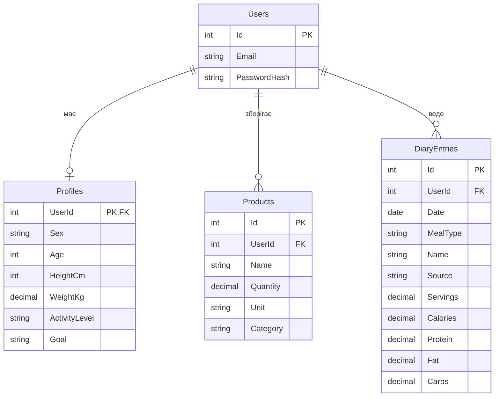

# Модель даних

Документ описує основні сутності SmartBite і зв'язки між ними.

## 1. ER-діаграма

## 2. Сутності

- **Users** - облікові записи. Пароль зберігається лише у вигляді хешу.
- **Profiles** - параметри для розрахунку норми. Профіль з'являється після першого заповнення, тому зв'язок з користувачем - "один до нуля або одного".
- **Products** - продукти, наявні в користувача, з кількістю, одиницею виміру та категорією.
- **DiaryEntries** - записи щоденника: дата, прийом їжі, назва, джерело (вручну, рецепт, оцінка), кількість порцій і КБЖВ однієї порції.

## 3. Основні рішення

- Добова норма не зберігається в базі: вона обчислюється з профілю за формулою Міффліна - Сан Жеора.
- Денний підсумок обчислюється як сума записів щоденника за дату; залишок - різниця між нормою і спожитим.
- Запис щоденника зберігає власну назву і КБЖВ, тому не залежить від продуктів: зміна або видалення продукту не змінює вже внесені записи.
- Рецепти та фотографії страв у базі не зберігаються.
- Дані кожного користувача доступні лише йому і видаляються разом з обліковим записом.
